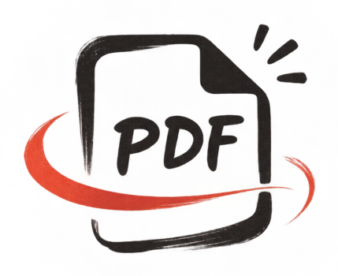

# 🌸 CutiPDF (ちいさな PDF スタジオ) — cutipdf.com

<div align="center">
  
  <p><strong>A modern, minimalist Japanese-inspired PDF studio with 100% in-browser client-side conversion.</strong></p>
  <p>Designed for fast, private, and international workflows. Inspired by iLovePDF and Documents by Readdle.</p>
</div>

[](https://opensource.org/licenses/MIT)
[](#)
[](https://weir-doabby.github.io/cutipdf/)

---

## ✨ Features

- 🎨 **Visual Identity Inspired by Logo:**
  - Japanese minimalist calligraphy-inspired aesthetic with deep sumi-e ink black (`#18181B`) and dynamic Japanese crimson accents (`#E63946`).
  - Warm washi paper canvas texture and subtle rounded card architecture.

- 🖼️ **Multi-Image to PDF Workspace (iLovePDF & Documents by Readdle Style):**
  - **Batch Multi-Select:** Choose multiple JPG, PNG, and WebP images all at once.
  - **Visual Thumbnail Gallery:** Real-time page number badges (`Page 1`, `Page 2`, ...), image resolution, and file size.
  - **Interactive Controls:**
    - 🔄 **90° Rotation** per individual image.
    - ⬅️ ➡️ **Reorder & Rearrange** page order with single clicks.
    - 🗑️ **Delete / Replace** images seamlessly.
  - **Document Setup Drawer:**
    - Page Orientation: `Auto`, `Portrait`, `Landscape`.
    - Page Size: `Fit to Image`, `A4 (210 × 297 mm)`, `US Letter`.
    - Margins: `No Margin`, `Small (20pt)`, `Big (40pt)`.
    - Custom output PDF file naming.

- 📱 **Floating Bottom Navigation Bar:**
  - Instagram-style glassmorphism floating capsule at the bottom of the screen.
  - Prominent crimson center floating action button (**`+`**) with pulse animation for quick file uploads.
  - Tab controls for **Tools**, **Quick Convert**, and **History**.

- 📑 **Integrated PDF Toolbox:**
  - **JPG to PDF:** Convert collections of photos into a clean PDF.
  - **Merge PDF:** Combine multiple PDF files into one master document.
  - **Text to PDF:** Convert formatted notes and text into clean PDF documents.

- 🔒 **100% In-Browser Client-Side Privacy:**
  - Powered by `PDF-Lib`.
  - Zero files are uploaded to any external server. Everything is rendered and compiled directly in your web browser.

---

## 🚀 Getting Started

Open directly in your web browser, or serve with any static server:

```bash
# Clone the repository
git clone https://github.com/weir-doabby/cutipdf.git

# Navigate to project folder
cd cutipdf

# Run local development server
npx serve .
```

Or open `index.html` directly in Google Chrome, Safari, or Firefox!

---

## 🌐 Live Demo

Try it live on GitHub Pages:  
👉 **[https://weir-doabby.github.io/cutipdf/](https://weir-doabby.github.io/cutipdf/)**

---

## 📄 License

This project is licensed under the MIT License - see the [LICENSE](LICENSE) file for details.
